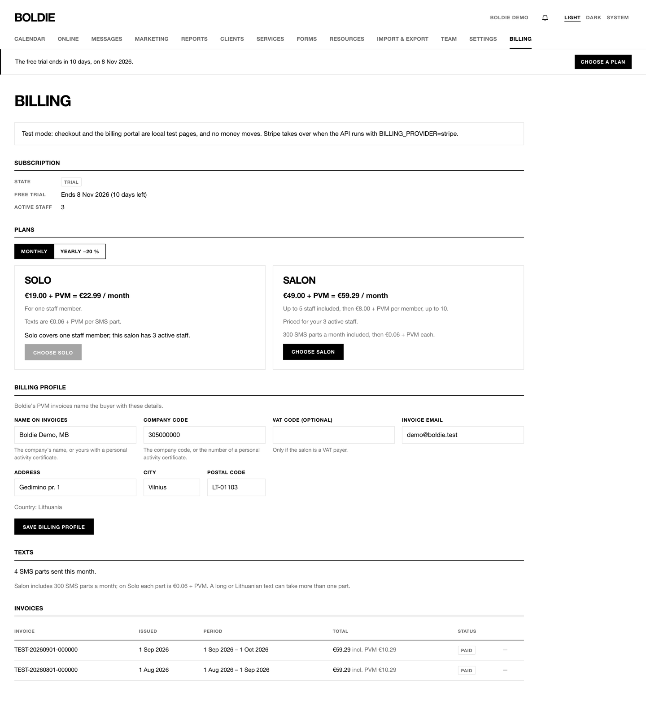

**Billing** is for the owner. Every new salon starts with a **30-day free trial**, no card needed.

| Plan | Monthly, without PVM | Monthly, with 21% PVM | Yearly (−20%), without PVM | Yearly, with PVM |
|---|---|---|---|---|
| **Solo** (1 staff member) | €19.00 | €22.99 | €182.40 | €220.70 |
| **Salon** (up to 5 staff) | €49.00 | €59.29 | €470.40 | €569.18 |
| Each extra staff member on Salon, 6th to 10th | +€8.00 | +€9.68 | +€76.80 | +€92.93 |
| Salon with 10 or more staff (price cap) | €89.00 | €107.69 | €854.40 | €1,033.82 |

- **Texts:** Salon includes 300 SMS parts a month (3,600 a year on yearly billing). Solo includes none. Each extra part
  costs €0.06 without PVM. A part is up to 160 plain characters, or 70 with Lithuanian letters.
- Prices with PVM are rounded to the cent; the Stripe invoice is the binding figure.
- Staff above ten cost nothing extra.

## Choose a plan

1. Press **Choose a plan** on the trial banner, or open **Billing**.
2. Pick **Monthly** or **Yearly −20 %**, then **Choose Solo** or **Choose Salon**.
3. Fill in the **Billing profile** (name on invoices, company code, VAT code, invoice email, address).
4. Pay on the secure checkout page. **Manage billing** later opens the billing portal for card changes and
   cancellation.

**Invoices** lists every invoice as a PDF. **Texts** shows this period's SMS use.

**If a payment fails** or the trial ends without a plan, a banner warns everyone and there is a grace period (7 days
after the trial, 14 days after a failed payment). After that the salon is paused: online booking, marketing and texts
stop; the calendar, clients, forms and export keep working.

> Billing was in test mode when this guide was written: checkout is a local test page and no money moves.
