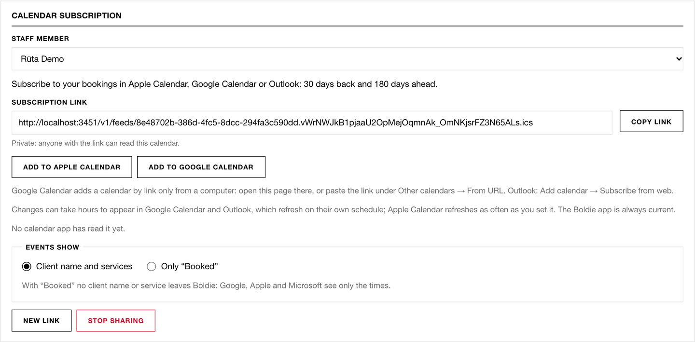

See your Boldie bookings in Apple Calendar, Google Calendar or Outlook.

**Settings → Calendar subscription** (staff see their own; owners and managers can pick any staff member):

1. Choose **Events show**: **Client name and services**, or **Only "Booked"** (no client names leave Boldie).
2. Press **Create link**.
3. **Add to Apple Calendar** or **Add to Google Calendar**, or **Copy link** and add it in Outlook (Add calendar → From
   web).

The feed covers 30 days back and 180 days ahead. It is one-way: changes in your phone calendar do not come back to
Boldie. Google and Outlook refresh on their own schedule, which can take hours; the Boldie app is always current.
**New link** replaces the address (the old one stops working). **Stop sharing** turns it off.
