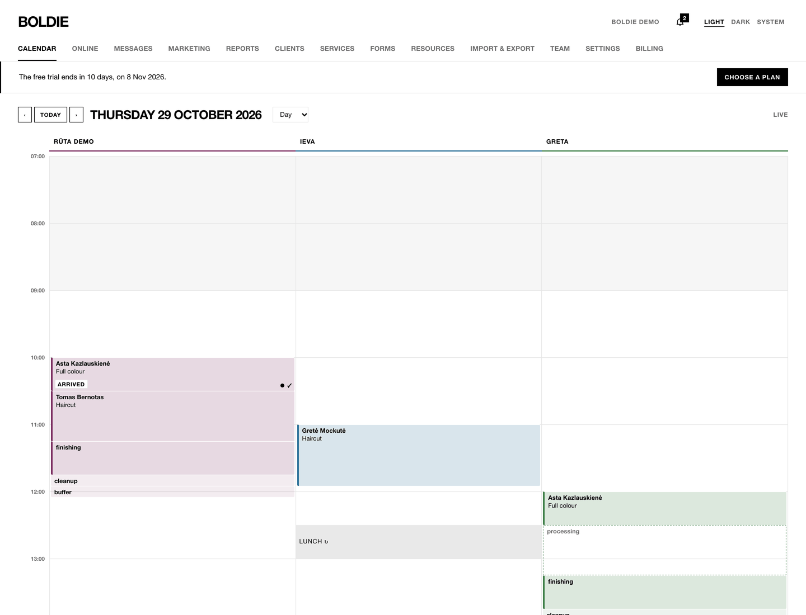
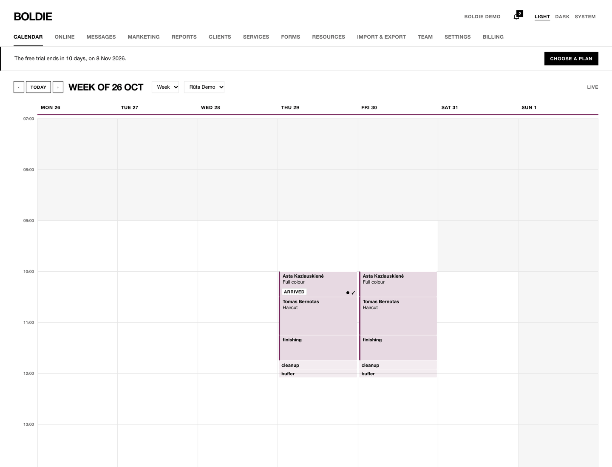
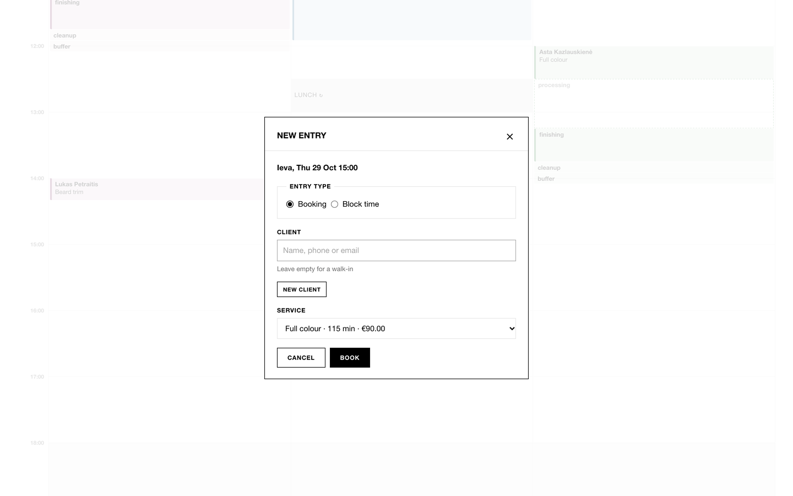
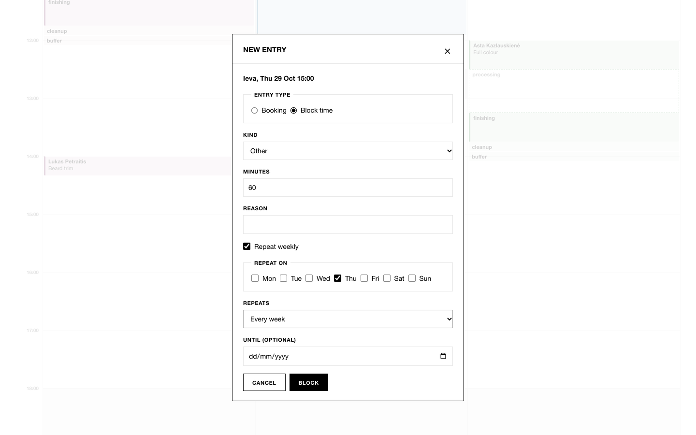
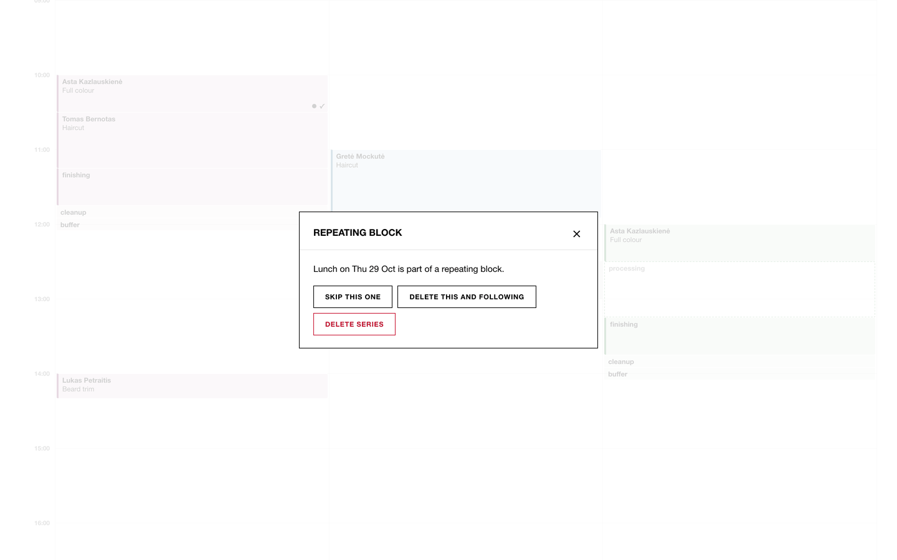
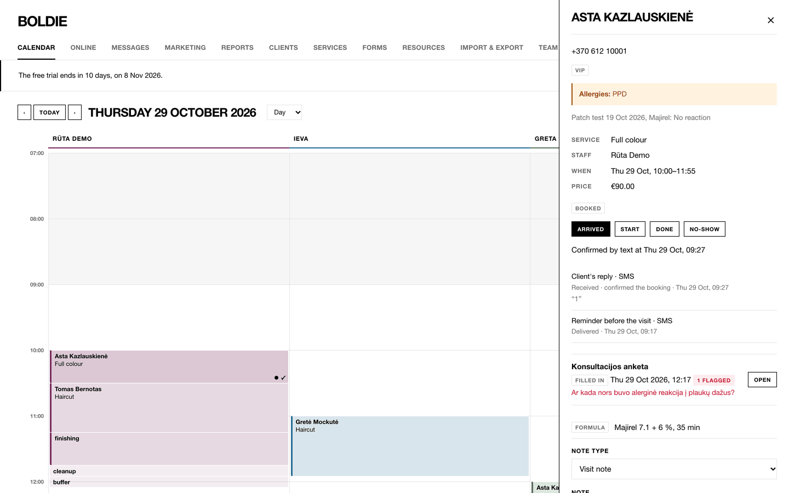
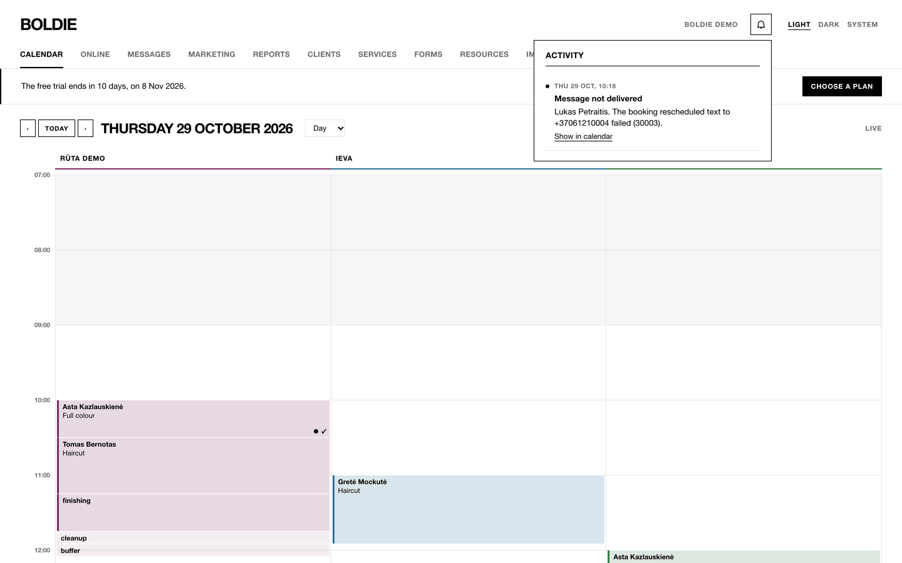

**Calendar** is the first tab. Every role has it.

## Reading the calendar

- **Columns:** one per staff member, with their colour under the name. Grey shading is time outside working hours.
- **A service is drawn in its steps.** A full colour is *Active* (applying), *Processing* (developing), *Finishing* and
  *Clean-up*. During processing the box turns into a dashed outline labelled **processing**: the stylist is free, so
  another client can be booked into that time. In the demo, Tomas's haircut sits inside Asta's colour processing.
- **cleanup** and **buffer** show the time after a visit that keeps the chair or the stylist busy.
- **Shaded blocks** are breaks, training, time off or other blocked time. A small ↻ means the block repeats.
- **Status badge** on a box: ARRIVED, IN PROGRESS, DONE or NO-SHOW.
- **Marks at the bottom right of a box** tell you about the reminder text and the client's reply:

| Mark | Meaning |
|---|---|
| ○ | Reminder sent |
| ● | Reminder delivered |
| ! (red) | Reminder failed: phone the client |
| ✓ | Client confirmed (replied "1") |
| × | Client asked to cancel (replied "2"): phone the client |

- A box with a white fill and a coloured outline is an online booking **awaiting approval**.
- **⚠ Overlapping (override)** marks a booking that was placed on top of another on purpose.
- **Live** at the top right means the calendar is up to date. **Syncing…** means it is catching up. **Offline** means you
  are seeing the last saved copy; changes need a connection.

## Moving around

- **‹** and **›** move a day (a week in week view). **Today** jumps back.
- **Day / Week:** week view shows seven days for one staff member; pick whose with the staff menu next to it.

## Book a client

1. Click an empty time in the right column. **New entry** opens with the staff member and time filled in.
2. Under **Client**, search by name, phone or email. Or choose **New client** and type their name and phone. Leave it
   empty for a walk-in.
3. Pick the **Service**. Each staff member's own length and price are shown.
4. Press **Book**.

If the time is outside the staff member's working hours, Boldie asks whether to **Book anyway**. If the stylist, a
needed chair or the time is already taken, Boldie explains why and does not book. Two bookings can never hold the same
stylist or the same chair by accident.

## Block time

1. Click an empty time and choose **Block time**.
2. Pick the **Kind** (Time off, Break, Training, Other), the **Minutes** and an optional **Reason**.
3. For a block that comes back every week, tick **Repeat weekly**, choose the days, how often (every week up to every
   4 weeks) and an optional end date.
4. Press **Block**.

Click a repeating block to **Skip this one**, **Delete this and following** or **Delete series**.

## Move or resize a booking

- **Drag** a booking to another time, or to another staff member's column in day view. In week view, dragging changes
  the day and keeps the staff member.
- **Drag the bottom edge** of a step to make it longer or shorter.
- Times snap to the salon's slot interval. If the new place is not free, the booking springs back and a short message
  says why. The client gets a "booking moved" message if that message is switched on.

## The booking sheet

Click a booking to open its sheet on the right.

From top to bottom:

- **Contact and warnings:** phone, tags, **Allergies**, the latest patch test, earlier no-shows, and whether the client
  is blocked from online booking.
- **Service, Staff, When, Price** and the status.
- **Status buttons.** The buttons change with the status:

| Status | Buttons |
|---|---|
| Booked | Arrived, Start, Done, No-show |
| Arrived | Start, Done, Undo arrival |
| In progress | Done, Back to arrived |
| Done | Reopen |
| No-show | Undo no-show |

  **Arrived** and **Start** open 60 minutes before the visit. **Done** and **No-show** open at the start time. A
  greyed-out button tells you when it opens.
- **Text replies:** "Confirmed by text at …" or "Asked to cancel by text at … Call the client."
- **Messages** sent about this booking and their delivery status.
- **Forms** linked to the visit, with any flagged answers in red. **Open** shows the answers.
- **Notes:** choose **Visit note** or **Formula** and press **Add note**. Formulas show on the client's profile and
  on later bookings.
- **Open profile** goes to the client.
- **Cancel booking** asks for a reason and whether the client cancelled, then **Confirm cancellation**.

Pending online bookings show **Awaiting approval** with **Approve** and **Decline** at the top of the sheet.

## Activity

The bell at the top of every admin page counts new events: online bookings, cancellations, text replies, waitlist
offers and failed messages. Opening it marks them read. **Show in calendar** jumps to the booking.

