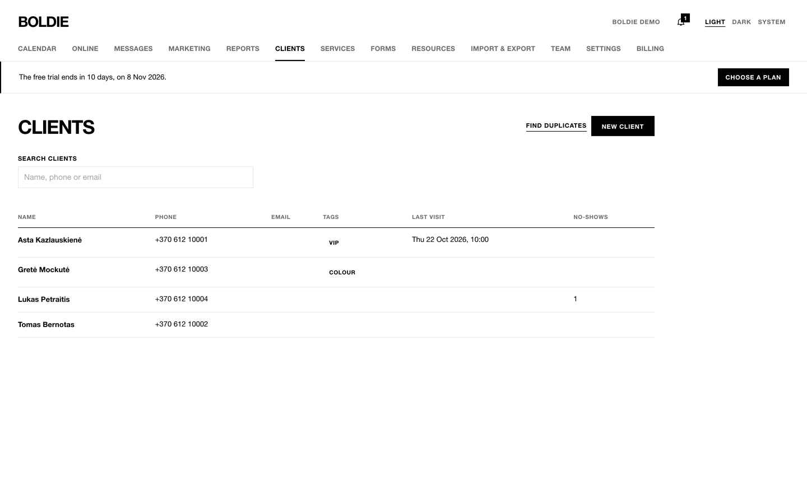
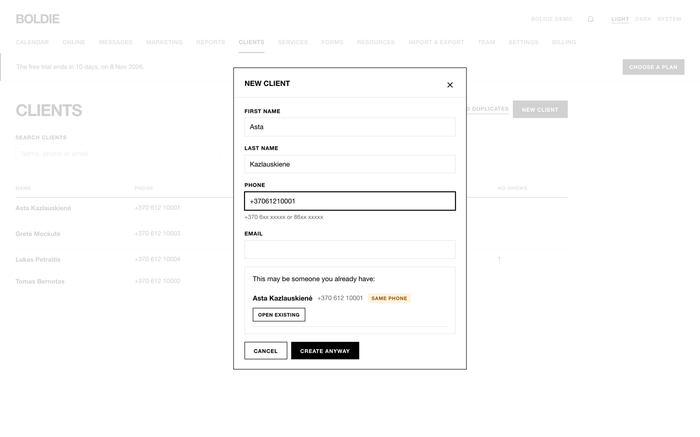
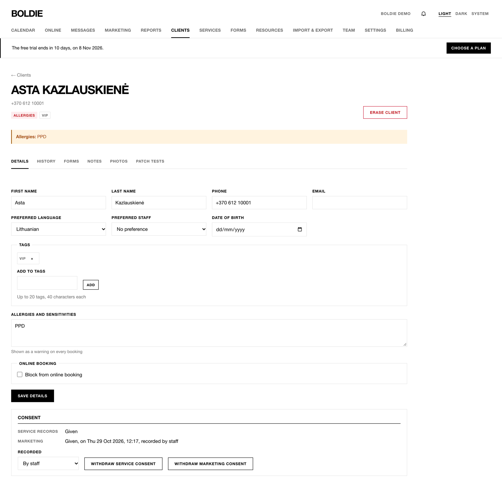
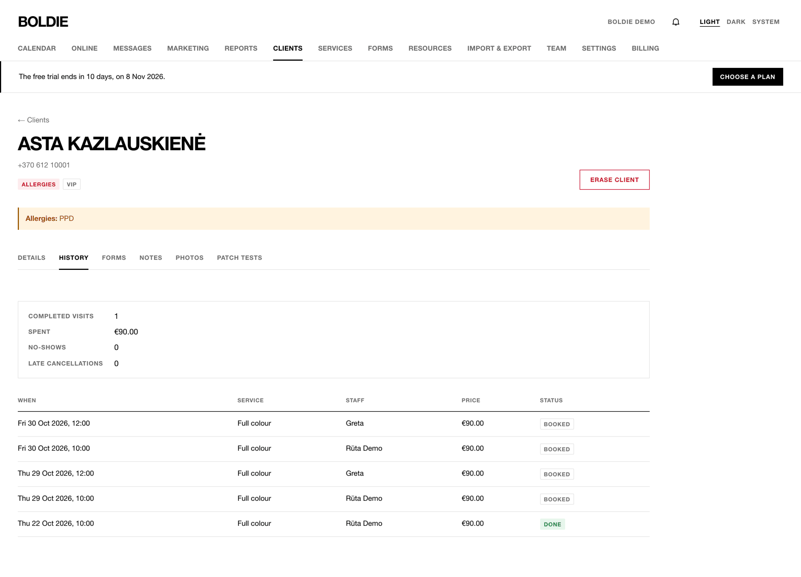
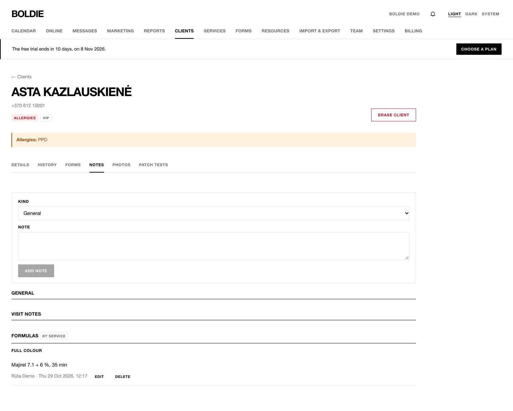
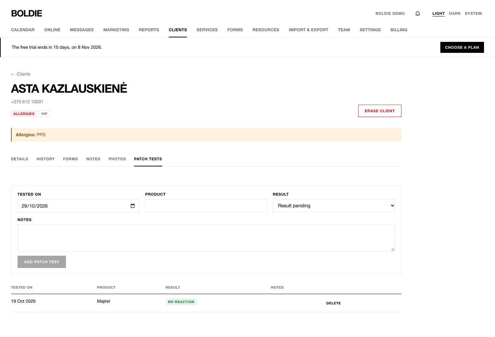
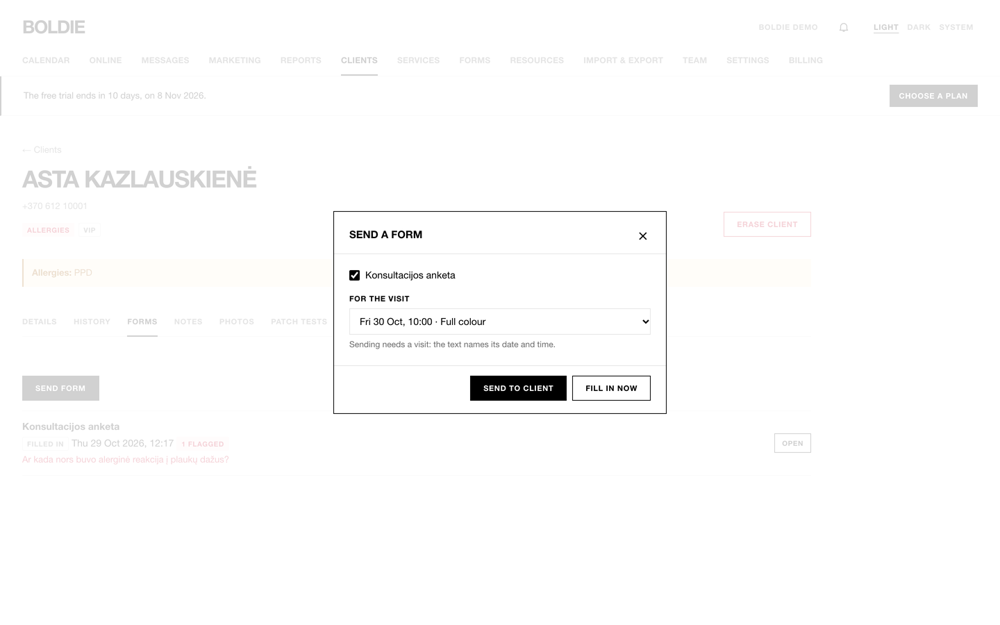

## Find a client

**Clients** lists everyone. Search by name, phone or email, or click a tag to filter. The list shows phone, email,
tags, last visit and no-shows.

## Add a client

1. Press **New client**.
2. Enter **First name**, **Last name**, **Phone** and **Email**.
3. If someone with the same phone, email or name exists, Boldie shows them. Press **Open existing**, or **Create
   anyway** if they really are a different person.

## The client profile

Click a name to open the profile. The header shows warnings: allergies, no-shows, late cancellations and tags.

**Details:** name, phone, email, **Preferred language** (Lithuanian or English: their texts come in this language),
**Preferred staff**, **Date of birth** (for birthday greetings), **Tags**, and **Allergies and sensitivities** (shown as
a warning on every booking). Owners and managers can **Block from online booking** with a staff-only reason. Press
**Save details**.

**Consent:** two separate consents.

- **Service records:** permission to keep notes, photos and formulas.
- **Marketing:** permission to send offers. Only clients with marketing consent receive campaigns and automations.

Each shows Given, Withdrawn or Not given, when and how it was recorded (at booking, by staff, by import, by a form,
by an SMS STOP, by the unsubscribe link). To change it, pick **By staff** or **At the client's request** under
**Recorded** and press **Record…** or **Withdraw…**.

**History:** completed visits, money spent, no-shows, late cancellations, and every booking.

**Notes:** choose **General**, **Visit** or **Formula** (a formula belongs to a service), write it and press **Add
note**. Notes can be edited and deleted.

**Photos:** choose Before, After or Other, add a caption and press **Upload photo** (JPEG, PNG, HEIC or WebP, up to
15 MB).

**Patch tests:** enter **Tested on**, **Product**, **Result** (pending, no reaction, reaction) and notes, then **Add
patch test**. The latest test shows on every booking sheet. Boldie does not decide when a test is out of date; the date
is shown so staff can judge.

**Forms:** every consultation form sent to the client, with flagged answers. **Send form** picks forms, the visit they
belong to, and either **Send to client** (by text or email) or **Fill in now** (opens the form at the desk, nothing is
sent).

## Erase a client

Owners and managers can **Erase client** on the profile. Type the client's name to confirm and press **Erase
permanently**. Notes, photos, patch tests and consents are deleted. Past bookings stay in the calendar without a name.
This cannot be undone.

## Merge duplicates

1. On **Clients**, press **Find duplicates**. Boldie groups clients with the same phone, the same email or the same name.
2. In a group, choose the **Client to keep**.
3. Press **Merge**. Bookings, notes, photos and consents move to the kept client. This cannot be undone.
