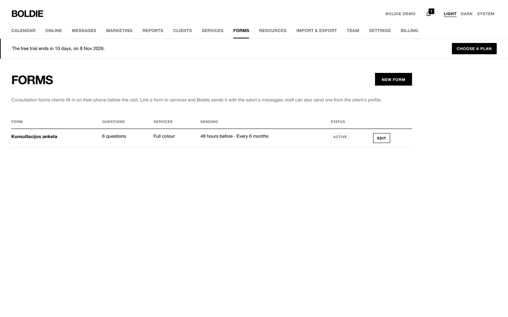
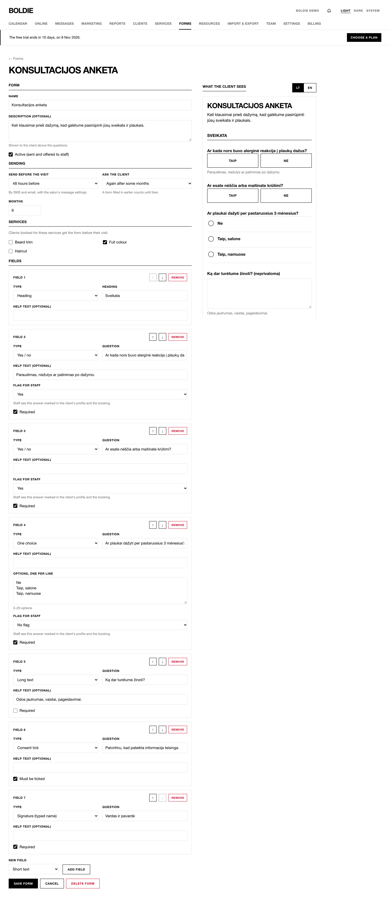
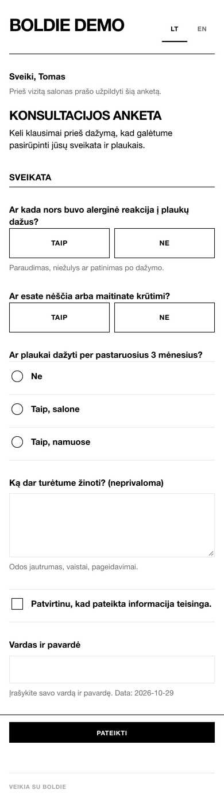

**Forms** (owners and managers) builds questionnaires that clients fill in before a visit: allergies, hair history,
medical questions, consent.

## Build a form

1. Press **New form** (or **Edit**).
2. Fill in **Name** and an optional **Description**. Tick **Active** to use it.
3. **Send before the visit:** off (staff send it), 24 h, 48 h, 72 h or 7 days before.
4. **Ask the client:** once per client, at every visit, or again after some months.
5. Link it to **Services**. Booking one of them sends the form automatically.
6. Add fields: short text, long text, one choice, several choices, yes/no, date, consent tick, signature (typed name),
   heading. Each can be **Required** and can **Flag for staff**: a flagged answer shows in red on the booking and the
   profile.

## Filling in

The client gets a link by text or email and fills the form in on their phone. A form link stops working a day after the
visit, or 14 days after sending when there is no visit.

At the desk, use **Fill in now** on the client's profile or booking sheet to open the form on the salon's device.
Answers appear on the profile under **Forms** and on the booking sheet.
