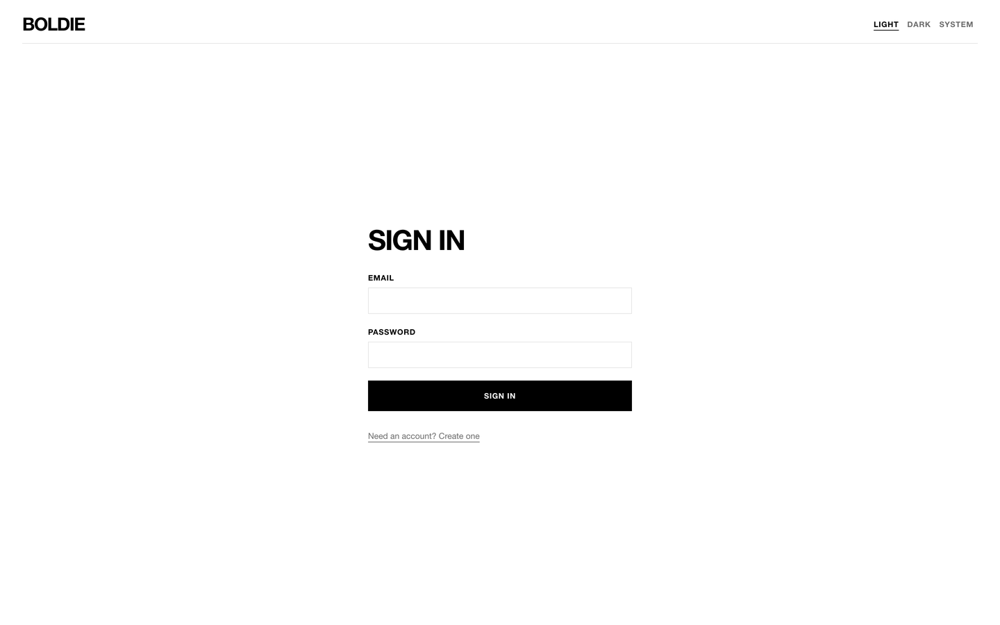
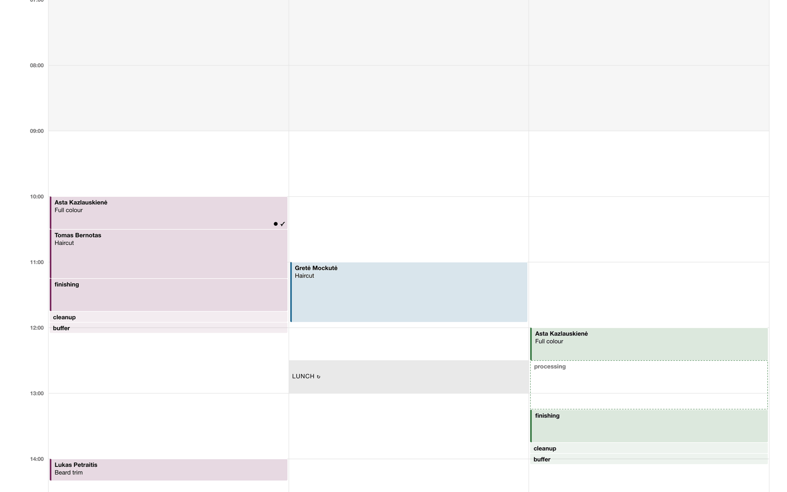
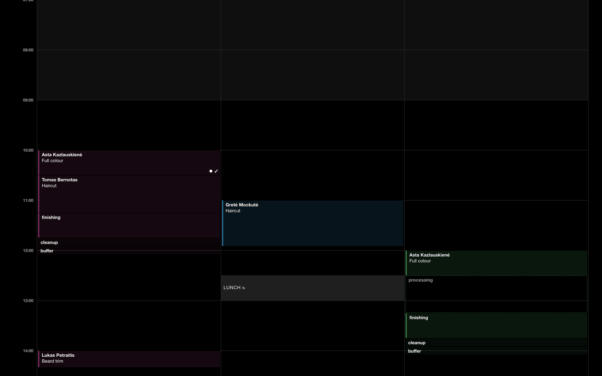

## What you use where

| You are | You use | For |
|---|---|---|
| Owner or manager | The web app on a computer or tablet | Everything: calendar, clients, services, online booking, messages, marketing, forms, reports, team, settings, billing |
| Staff member | The Boldie app on your phone, and the web app if you like | Your calendar, your clients, booking statuses, notes, photos, forms, online requests |
| Client | The salon's booking page in any browser | Booking, moving and cancelling visits, the waitlist, forms. Clients never install an app |

## Signing in (web)

1. Open the Boldie web address and choose **Sign in**.
2. Enter your **Email** and **Password** and press **Sign in**.
3. You land on the calendar. If you belong to more than one salon, a salon picker sits at the top right.

New here? **Need an account? Create one** makes an account with your name, email and a password of at least 10
characters. An account alone is not a salon. You join a salon by accepting an invitation (see
[Team and roles](/team/)), or the Boldie team creates your salon with you during onboarding (below).

There is no "forgot password" link yet. If you lose your password, contact Boldie.

## Setting up a new salon

Some setup has no screen in Boldie yet, so the Boldie team does it with you during onboarding:

- creating the salon itself (its name and time zone);
- creating a calendar column for each staff member;
- each staff member's working hours (rotating weekly rosters) and days off or closures.

Everything else you can do yourself, in this order:

1. **Settings → Location:** slot interval and the hours the calendar shows ([Settings reference](/settings/)).
2. **Resources:** chairs, basins, rooms ([Services and resources](/services-and-resources/#resources)).
3. **Services:** categories, services, their steps, and which staff perform them ([Services and resources](/services-and-resources/#services)).
4. **Team:** invite managers and staff and link each to their column ([Team and roles](/team/)).
5. **Import & export:** bring in your client list, or send it to Boldie to import for you ([Import and export](/import-and-export/)).
6. **Settings → Notifications:** reminders, quiet hours, sender name ([Notifications and messages](/notifications/)).
7. **Settings → Online booking:** turn on the booking page and add it to your website ([Online booking](/online-booking/)).
8. **Billing:** choose a plan before the 30-day trial ends ([Billing and plans](/billing/)).

## Light and dark

The web app has **Light**, **Dark** and **System** at the top right. System follows your computer. The phone apps
follow the phone's setting.

| Light | Dark |
|---|---|
|  |  |

## Language

- The booking page, client texts, emails and forms are in Lithuanian and English. Each client gets their preferred
  language.
- The web admin and the phone apps are in English only for now.
