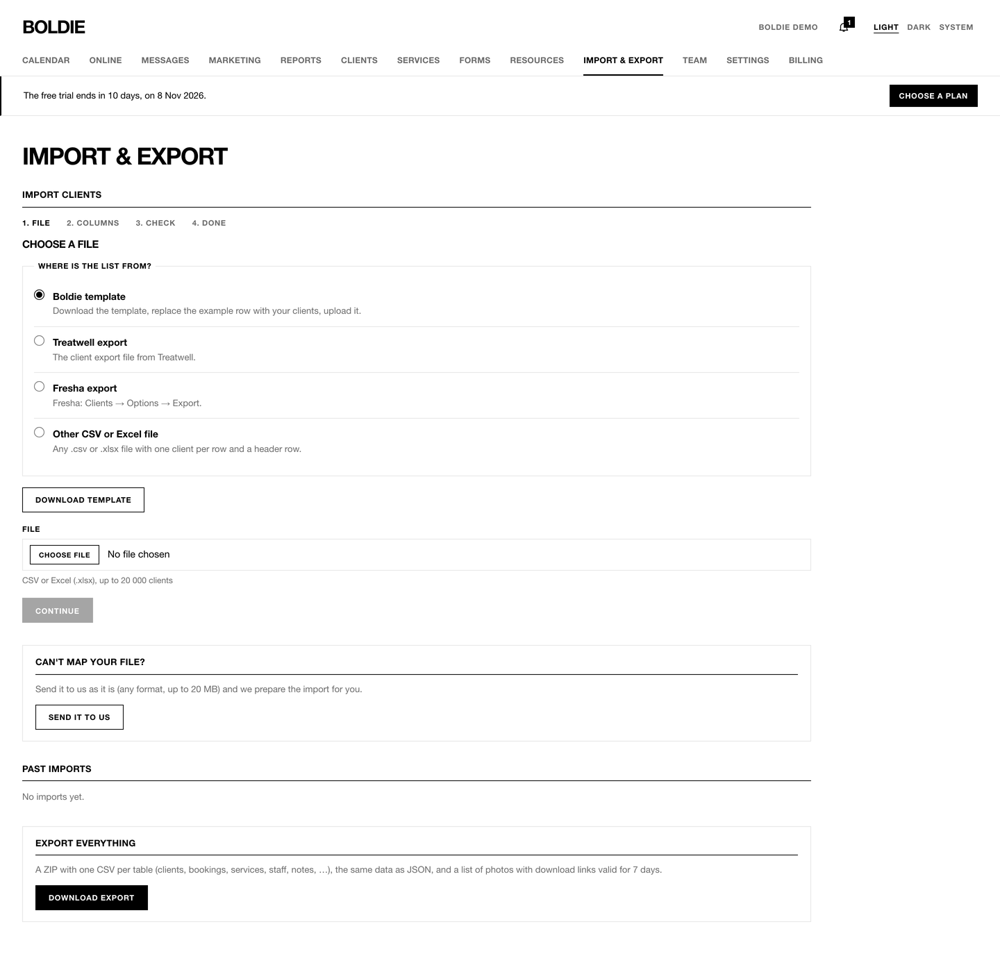
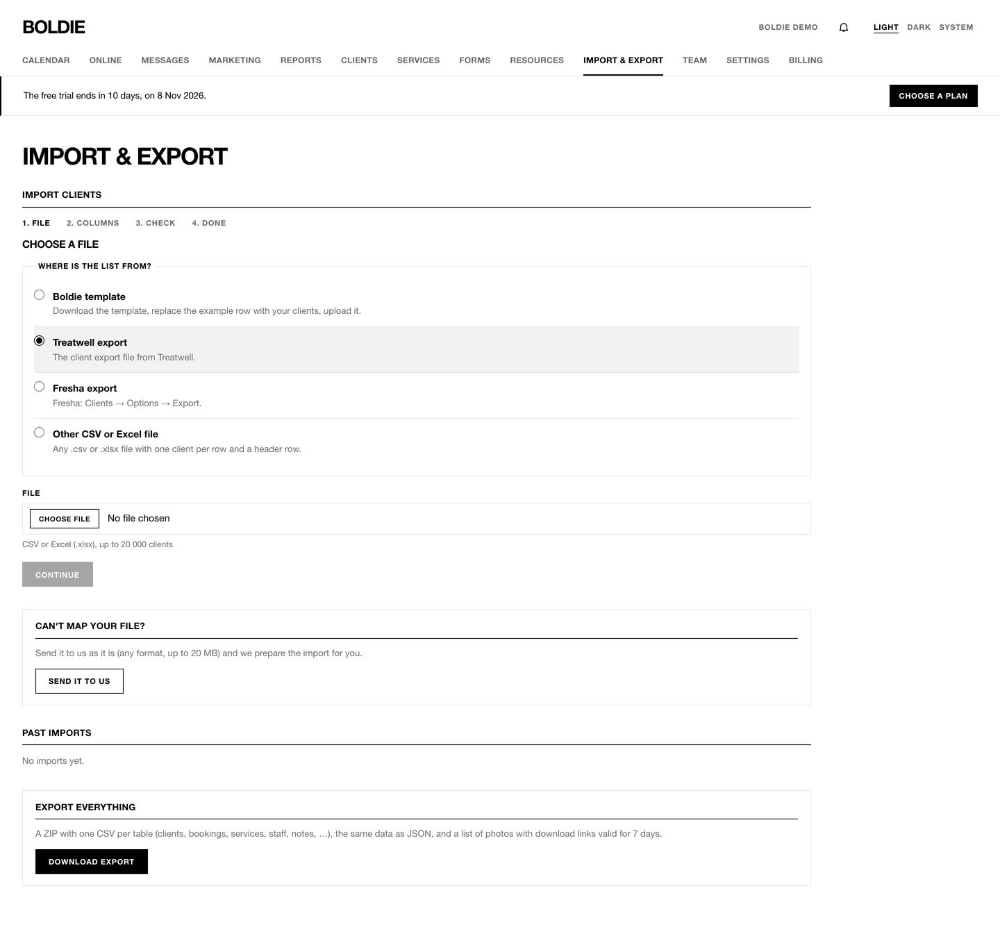
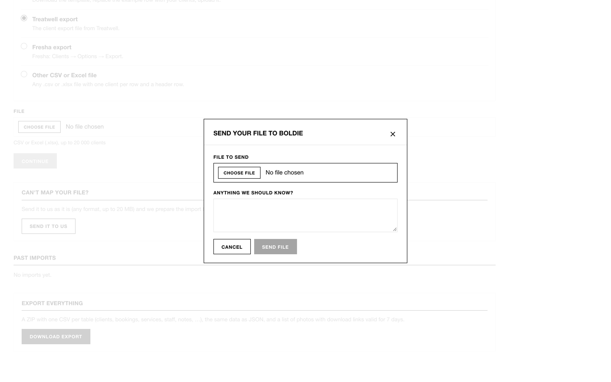

**Import & export** is for owners and managers.

## Import your client list

1. Under **Where is the list from?** choose **Boldie template** (press **Download template** first), **Treatwell
   export**, **Fresha export** (in Fresha: Clients → Options → Export) or **Other CSV or Excel file**.
2. Choose the file: CSV or Excel (.xlsx), up to 20,000 clients and 20 MB.
3. **Match the columns.** Boldie guesses each column (English and Lithuanian headings). Correct any guess, or choose
   **Don't import**.
4. **When a row matches an existing client:** **Skip the row**, **Update the existing client** or **Create a new client
   anyway**.
5. Add up to five **Tags for imported clients** (for example "from-treatwell").
6. Press **Preview**. Boldie counts rows ready to import, rows with errors (skipped) and possible duplicates.
7. Import. Press **Undo this import** if something looks wrong. Undo removes the clients the import created, unless
   they have been used since.

A marketing-consent column is imported as consent recorded "by import". Visit history is not part of a Treatwell
client export, so it cannot be imported from it.

## Done-for-you import

If your file does not fit, the owner can press **Send it to us** under **Can't map your file?**. Attach the file, add a
note and press **Send file**. This gives the Boldie support team access to your salon for 14 days so they can import it
for you. You can revoke that access at any time in **Settings → Support access**.

**Past imports** lists every import with its status, **Undo** and **Download original**.

## Export everything

The owner can press **Download export** under **Export everything**. You get a ZIP with one CSV file per table (clients,
bookings, notes, consents and more) plus a JSON copy. Photos are included as download links that work for 7 days.
