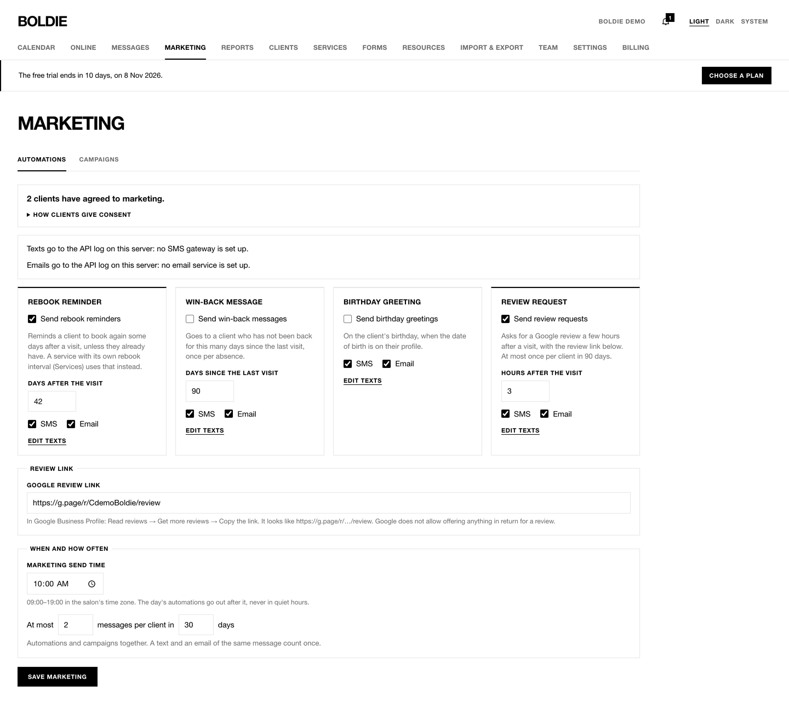
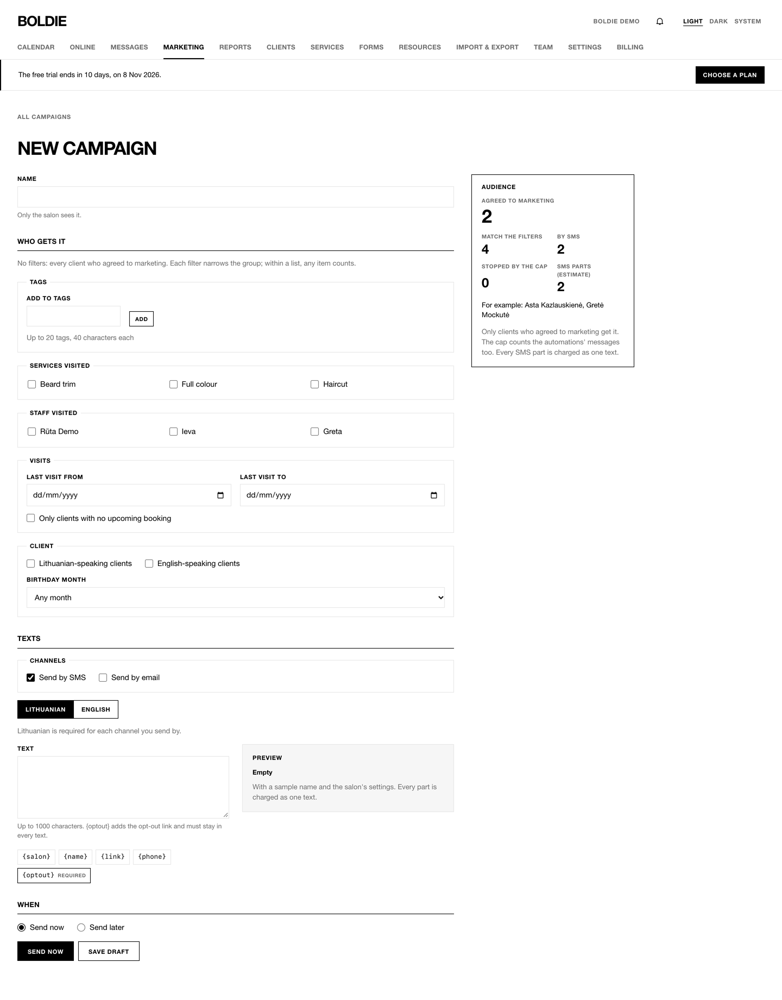
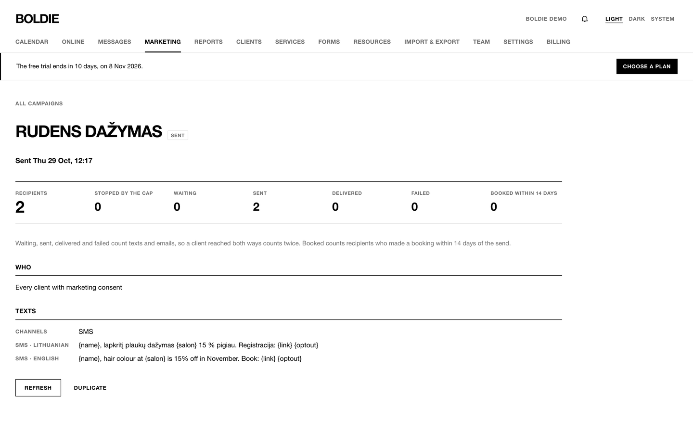
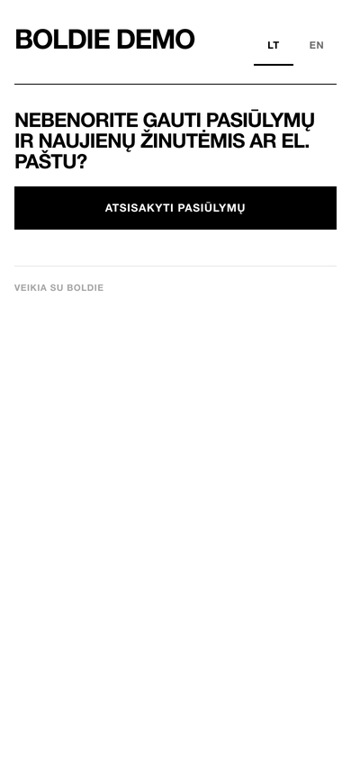

**Marketing** is for owners and managers. Marketing messages only reach clients who gave marketing consent, and every
text carries an opt-out link.

## Automations

All are off until you turn them on.

| Automation | When it sends | Default |
|---|---|---|
| Rebook reminders | A set number of days after a visit (7–365) | 42 days |
| Win-back messages | When a client has not visited for a while (30–730 days) | 90 days |
| Birthday greetings | On the client's birthday | |
| Review requests | 1–72 hours after a visit, at most once per client in 90 days, with your Google review link | 3 hours |

Each can go by SMS and/or email, with **Edit texts** for the wording. **Marketing send time** (09:00–19:00, default
10:00) sets when automations go out. The **frequency cap** limits marketing per client, by default at most 2 messages in
30 days. Press **Save marketing**.

## Campaigns

1. **Marketing → Campaigns → New campaign.**
2. Give it a **Name**.
3. **Who gets it:** filter by tags, services visited, staff visited, last visit dates, only clients with no upcoming
   booking, language, or birthday month. The audience panel shows how many agreed to marketing, how many match, how
   many get SMS or email, how many the frequency cap stops, and an estimate of SMS parts.
4. **Texts:** Lithuanian is required, English optional. Keep {optout} in every text.
5. **When:** **Send now**, or **Send later** (up to 60 days ahead, outside quiet hours).
6. **Save draft**, then send.

The campaign page shows recipients, waiting, sent, delivered, failed and **Booked within 14 days**. A scheduled campaign
can be cancelled; any campaign can be duplicated.

## Unsubscribing

Each marketing text ends with an opt-out link. The client presses **Unsubscribe from offers** and stops getting
marketing; visit messages still arrive. Replying STOP stops all texts from the salon.

