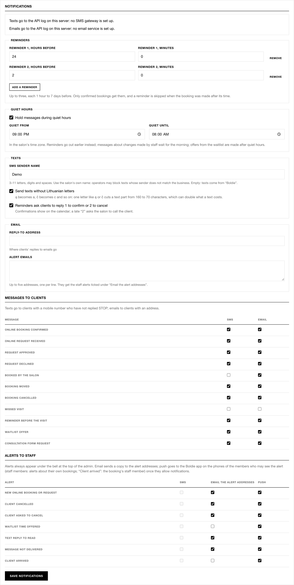
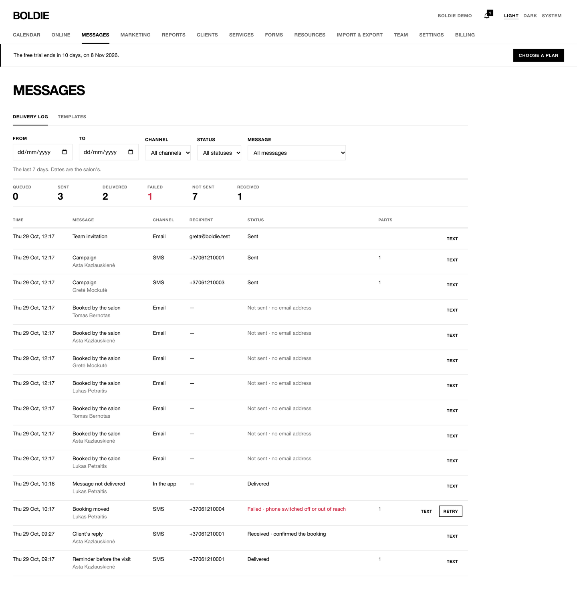
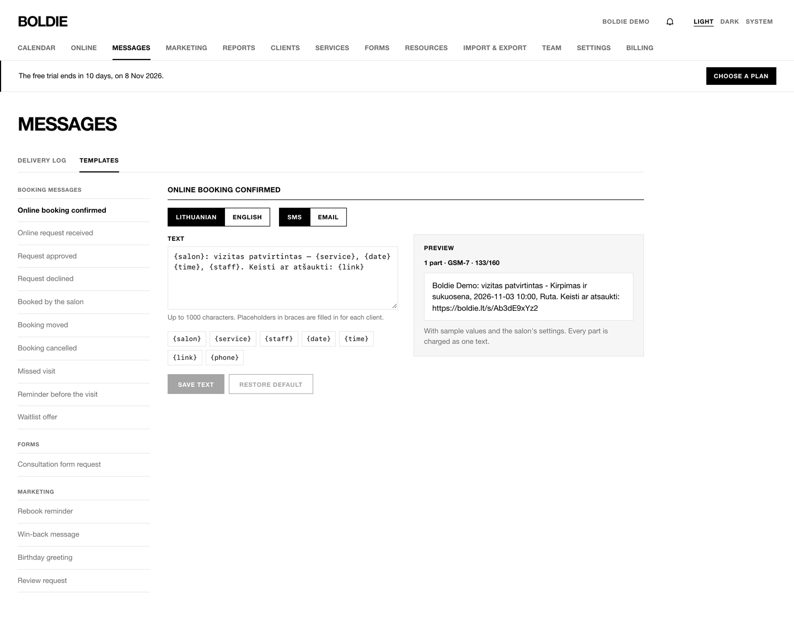

## What gets sent

Boldie texts and emails clients about their visits, and alerts staff about events that need them.

**Settings → Notifications** (owners and managers):

**Reminders.** Up to three, each from 1 hour to 7 days before the visit. Default: one reminder 24 hours before. Only
confirmed bookings get reminders, and a reminder is skipped if the booking was made after its time.

**Quiet hours.** **Hold messages during quiet hours**, default 21:00 to 08:00. Reminders go out earlier instead;
messages about changes made by staff wait until the morning; waitlist offers are made after quiet hours.

**Texts.**

- **SMS sender name:** 3 to 11 letters, digits and spaces. Use the salon's own name: operators may block a sender that
  does not match the business.
- **Send texts without Lithuanian letters** (on by default): ą becomes a, č becomes c. One Lithuanian letter cuts a text
  part from 160 to 70 characters, which can double what a text costs.
- **Reminders ask clients to reply 1 to confirm or 2 to cancel** (on by default). This needs a two-way number on the
  server.

**How clients reply by text:**

| Client sends | Result |
|---|---|
| 1 or TAIP | The booking is marked confirmed (✓ on the calendar) |
| 2, before the "online changes until" deadline | The booking is cancelled as if the client used their manage link; staff get a "client cancelled" alert and the time can go to the waitlist |
| 2, after that deadline | Nothing is cancelled. The booking shows × "asked to cancel" and staff get an alert: phone the client and decide |
| STOP, STOPAS, ATSISAKYTI … | No more texts to this number from your salon (one-time codes still go) |
| START, PRADETI | Texts resume |
| Anything else | Staff get a "text reply to read" alert |

**Email.** A **Reply-to address** for client replies, and up to five **Alert emails** that receive staff alerts.

**Messages to clients** chooses SMS and/or email for each message: online booking confirmed, request received,
approved, declined, booked by the salon, moved, cancelled, missed visit, reminder, waitlist offer, consultation form
request.

**Alerts to staff** chooses email and push for each alert: new online booking or request, client cancelled, client
asked to cancel, waitlist time offered, text reply to read, message not delivered, client arrived. Alerts always appear
under the bell in the web app.

Press **Save notifications**.

## Delivery log

**Messages → Delivery log** shows every text and email: time, message, channel, recipient, status and SMS parts. Filter
by dates (up to 92 days), channel, status or message. Failed messages have **Retry**.

## Templates

**Messages → Templates** holds the wording of every message, in Lithuanian and English, for SMS and email.

1. Pick a message, the language and the channel.
2. Edit the **Text** (and **Subject** for email). Placeholders in braces are filled in for each client: {salon}
   {service} {staff} {date} {time} {link} {phone} {minutes} {reply} {name} {optout}.
3. The preview counts SMS parts, for example "1 part · GSM-7 · 132/160".
4. **Save text**. **Restore default** undoes your changes. Edited templates are marked **Edited**.

