## Switch it on

**Settings → Online booking** (owners and managers):

1. Tick **Clients can book online**. On a live server this needs the SMS service, because clients confirm their phone
   with a code.
2. Choose the **Booking page address**, for example `demo` gives `…/demo`.
3. Decide whether **The salon approves each online booking**. With approval on, online bookings wait in **Online →
   Requests** and the client is told the salon will confirm.
4. Set the rules:

| Setting | What it does | Default |
|---|---|---|
| Online changes until (hours before) | Clients can move or cancel online until this many hours before the visit | 24 |
| Waitlist offer valid for (minutes) | How long a freed time is held for a waitlisted client | 30 |
| Offered start times every | Spacing of start times on the booking page | 15 minutes |
| Lead time, hours / minutes | No online bookings sooner than this | 2 hours |
| Bookable up to (days ahead) | How far ahead clients can book | 60 |
| Best times shown per day | How many recommended times show before "Show all times" | 6 |

5. Add the **Address** and **Phone** shown on the booking page.
6. Press **Save online booking**. **Open booking page** shows it.

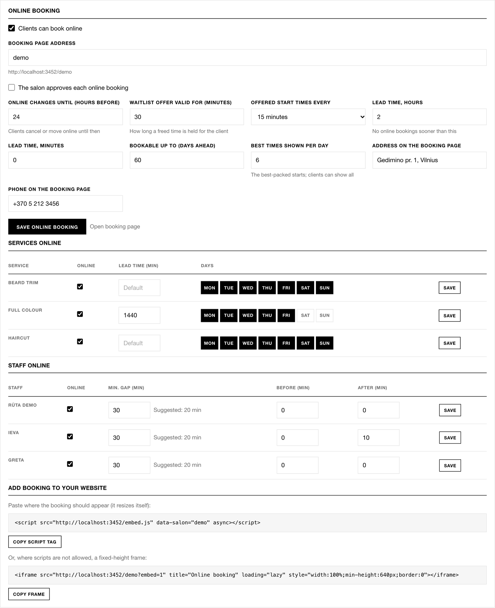

**Services online:** per service, whether it is online, its own lead time, and which weekdays it can be booked.
**Staff online:** per staff member, whether they take online bookings, the smallest gap they accept between clients
(**Min. gap**), and extra minutes **Before** and **After** each online client.

## Put it on your website

Under **Add booking to your website**, press **Copy script tag** and paste it where the booking should appear. It resizes
itself. Where scripts are not allowed, use **Copy frame** for a fixed-height frame.

## What your clients see

The booking page opens in Lithuanian; **EN** switches to English.

| 1. Choose services | 2. Choose a specialist | 3. Choose a time |
|---|---|---|
| 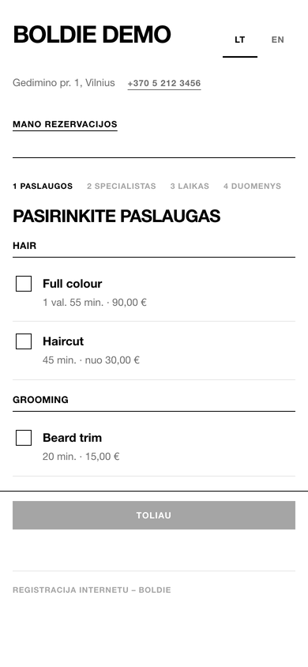 | 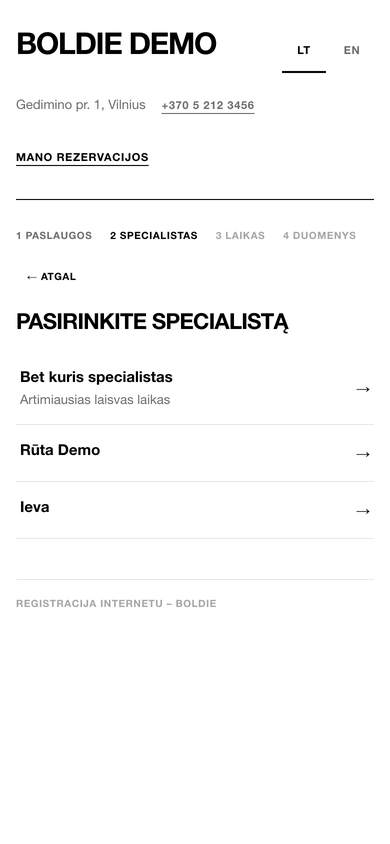 | 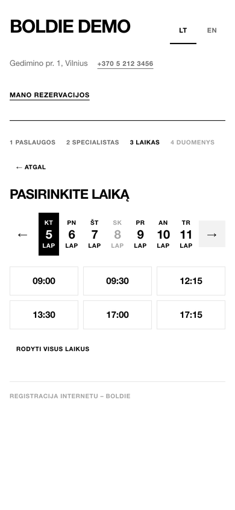 |

1. The client ticks up to five services and presses **Continue**.
2. They pick a specialist or **Any specialist** (the earliest free time).
3. Boldie shows the **best times** first: the starts that leave the fewest unusable gaps in your day. **Show all times**
   shows every free start. A day with no free times offers **Join the waitlist**.
4. Picking a time holds it for **5 minutes** while they finish.
5. They enter their **mobile number**, press **Send code** and type the six-digit code from the text. Codes last 10
   minutes.
6. They add their name, an optional email and note, and can tick **Send me offers and news** (marketing consent).
7. **Confirm booking.** The client gets a confirmation text with a link to manage the visit, and can **Add to
   calendar**.

| Time held | Phone code | Your details | Booked |
|---|---|---|---|
| 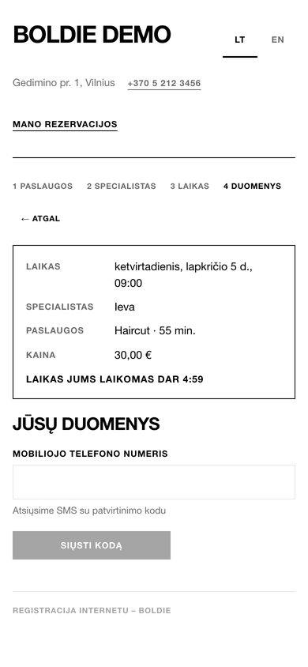 | 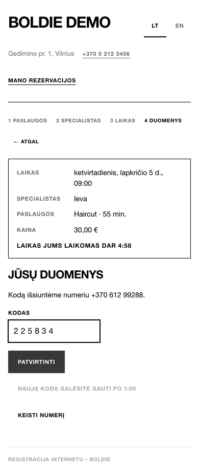 | 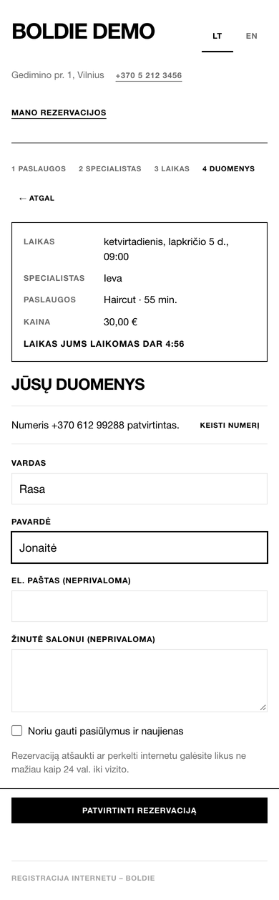 | 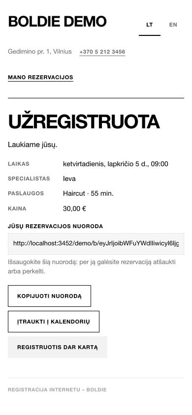 |

With approval on, the last screen says **Request sent** instead:

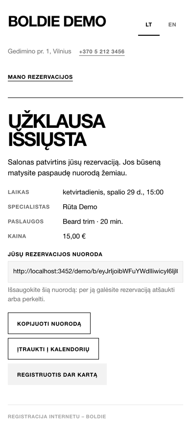

On a computer, in English:

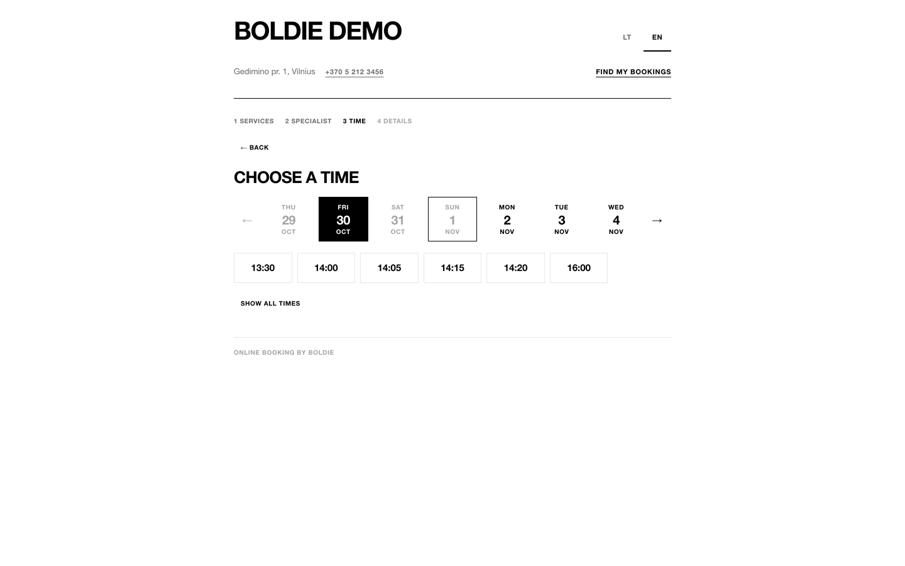

## Approve or decline requests

**Online → Requests** lists bookings waiting for approval. Press **Approve**, or **Decline** with an optional reason.
Declining frees the time and the waitlist can get it. You can also approve from the booking sheet in the calendar or in
the phone apps.

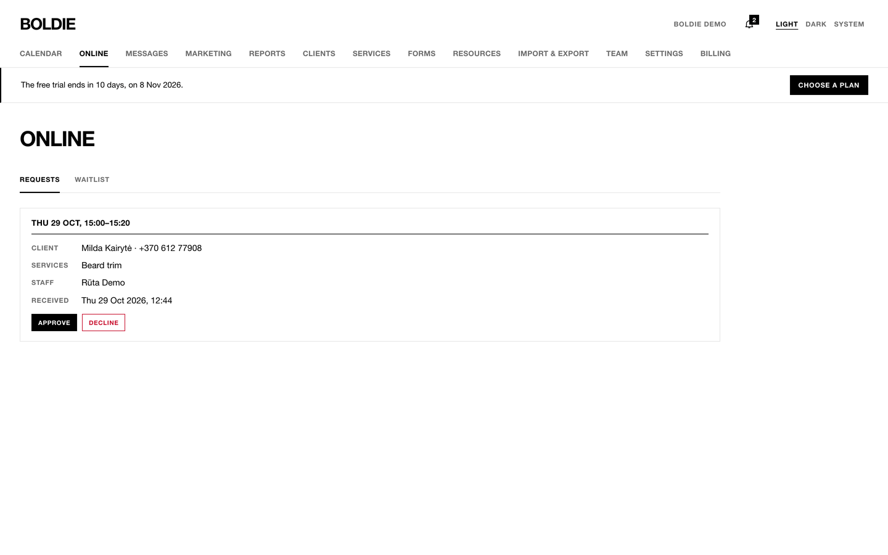

## The client's manage link

Every confirmation text has a link. The client can **Move to another time** or **Cancel booking** until the "online
changes until" deadline. After it, the page asks them to call the salon.

| Manage | Move |
|---|---|
| 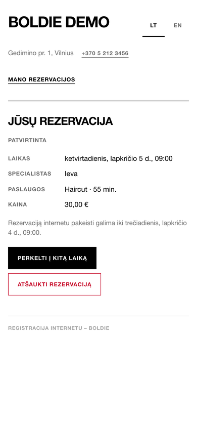 | 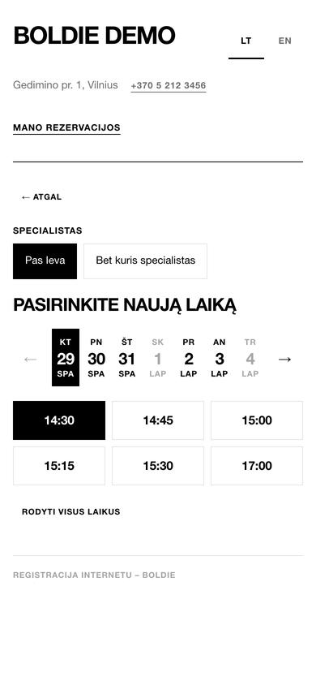 |

Clients can also use **Find my bookings** on the booking page: they confirm their phone and see their upcoming visits
and waitlist places.

## The waitlist

- Clients join from the booking page when a day is full. A client can be on at most three waitlists.
- Staff add clients in **Online → Waitlist → Add to waitlist**: service, staff, date range, time of day and priority.
- When a matching time frees up (a cancellation, a decline), Boldie texts the next client an offer. The time is held for
  them for the "waitlist offer valid for" minutes. They press **Book this time** or **Not this time**. If they do not
  answer, the offer goes to the next person.
- Offers are not sent during quiet hours.

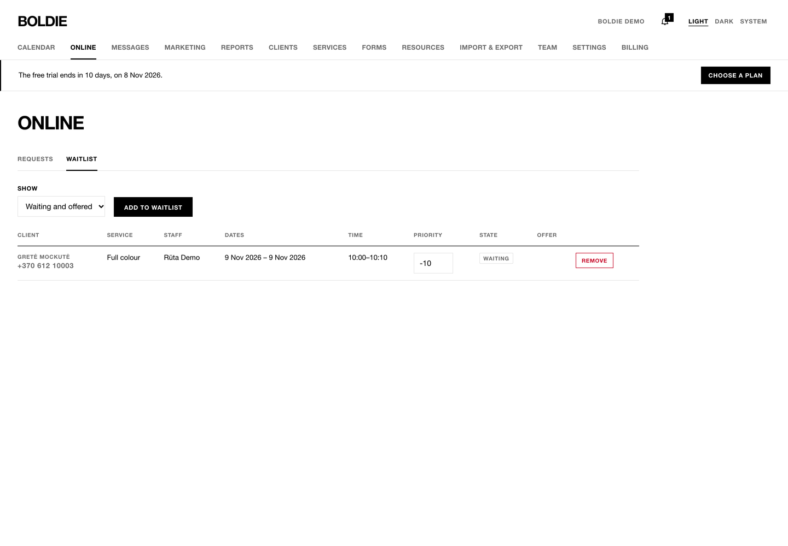

The client's offer page (screenshot from the phase 4 acceptance run):

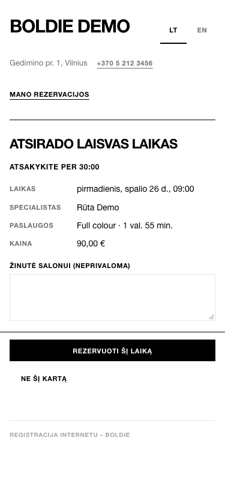
