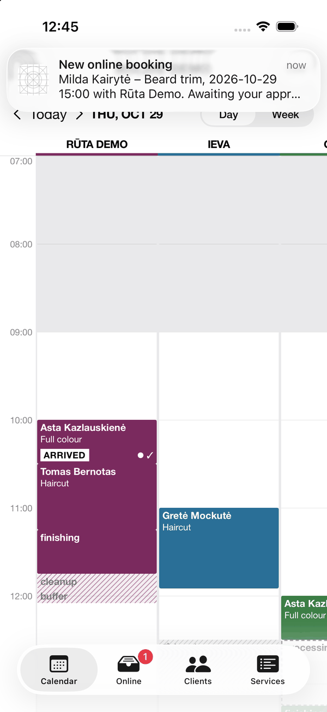
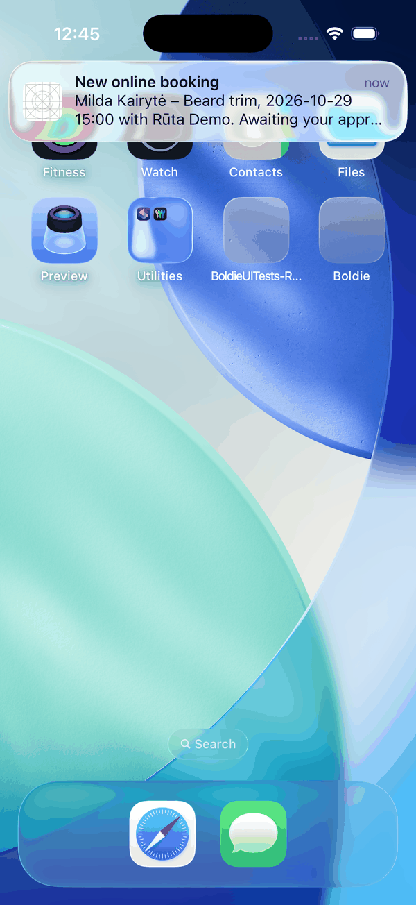

Staff with the Boldie app get alerts on their phone:

| Alert | Who gets it |
|---|---|
| New online booking (or request awaiting approval) | Owners and managers, and the staff member whose booking it is |
| Client cancelled | Owners and managers, and the staff member whose booking it is |
| Client asked to cancel (replied "2" too late to cancel by text) | Owners and managers, and the staff member whose booking it is |
| Waitlist offer sent | Owners and managers, and the staff member whose booking it is |
| Client replied (a text Boldie could not act on) | Owners and managers, and the staff member whose booking it is |
| Message not delivered | Owners and managers, and the staff member whose booking it is |
| Client arrived | Only the booking's own staff member |

The phone asks for permission after the first sign-in. Tapping an alert opens the calendar on that day with the
booking open. Owners and managers choose which alerts go by push in **Settings → Notifications → Alerts to staff**.

| Alert while the app is open | Alert on the home screen |
|---|---|
|  |  |

Clients never get push messages; they get texts and emails.
