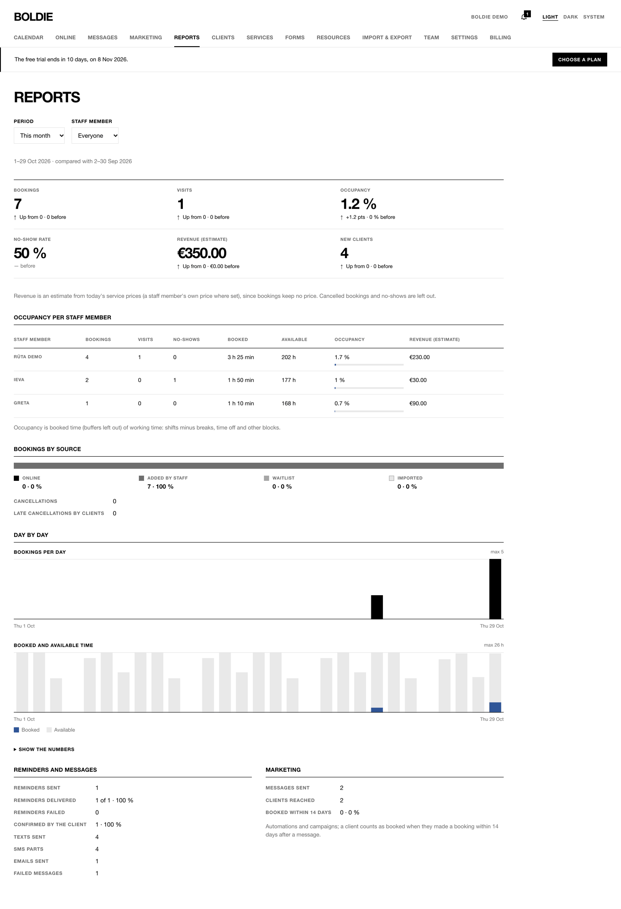

**Reports** (owners and managers):

1. Choose the **Period**: this month, last month, last 30 days, this year, or custom dates.
2. Choose a **Staff member** or **Everyone**.

You see bookings, visits, occupancy, no-show rate, estimated revenue and new clients, each compared with the previous
period. Further down: occupancy per staff member, bookings by source (online, added by staff, waitlist, imported),
day by day, cancellations, late cancellations, reminders and messages (sent, delivered, failed, confirmed, SMS parts)
and marketing results.

Revenue is an estimate from current service prices. It is not a record of payments. Reports cannot be exported yet.
