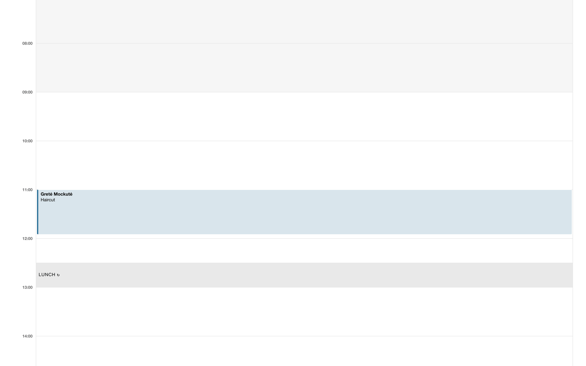

Boldie has three roles. The owner is the person who created the salon.

| | Owner | Manager | Staff |
|---|---|---|---|
| Calendar | All columns | All columns | Own column only (can see and change only their own bookings) |
| Online requests and waitlist | All | All | Own requests |
| Clients: view, add, notes, photos, patch tests, consent | Yes | Yes | Yes |
| Clients: block from online booking, erase, merge duplicates | Yes | Yes | No |
| Services and resources | Edit | Edit | View |
| Messages, Marketing, Reports, Forms, Import, Team | Yes | Yes | No |
| Settings: location, online booking, notifications | Yes | Yes | No |
| Calendar subscription | Any staff member | Any staff member | Own column |
| Export everything, done-for-you import, support access | Yes | No | No |
| Billing | Yes | No | No |

The navigation only shows what your role can use. Ieva, a staff member, sees her own column:

