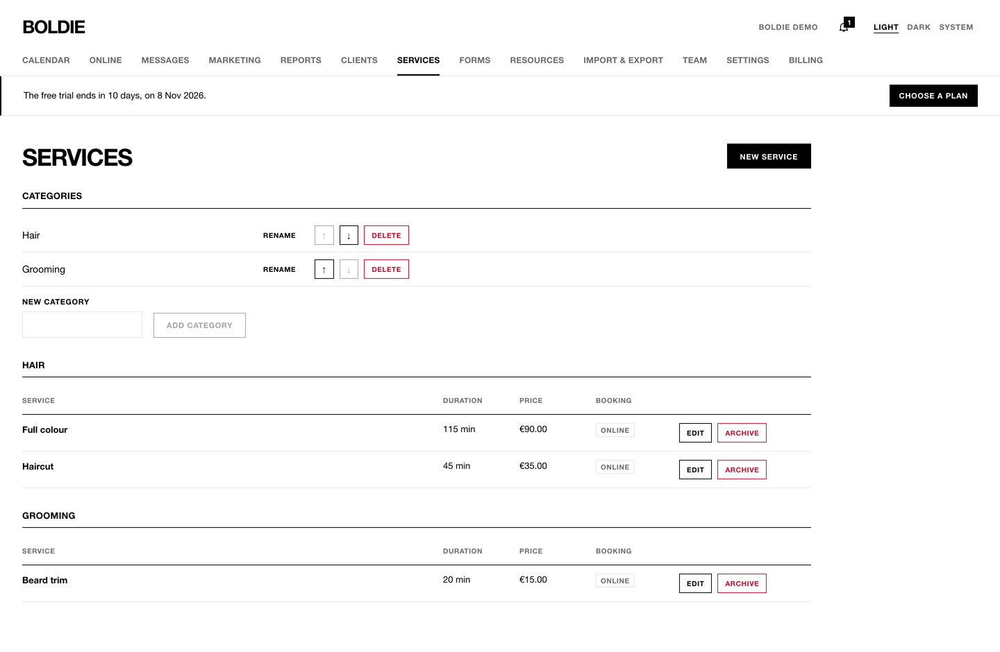
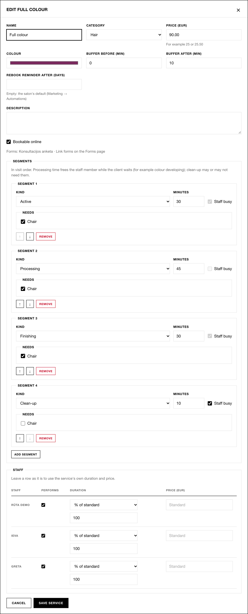
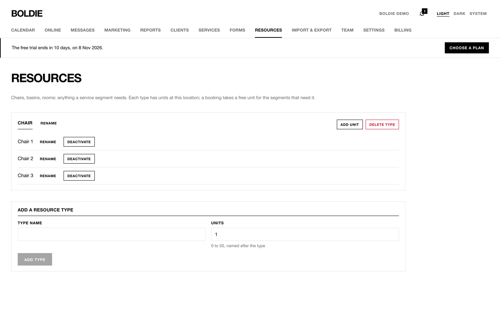

## Services

**Services** lists your categories and services. Everyone can see it. Owners and managers can change it.

**Add a category:** type a name under **New category** and press **Add category**. Use ↑ and ↓ to reorder.

**Add or edit a service:**

1. Press **New service**, or **Edit** on a service.
2. Fill in **Name**, **Category**, **Price (EUR)** and **Colour**.
3. **Buffer before / after (min):** time kept free around the visit.
4. **Rebook reminder after (days):** leave empty to use the salon default from Marketing.
5. **Bookable online:** whether clients see it on the booking page.
6. **Segments** describe the visit step by step. Each segment has a **Kind** (Active, Processing, Finishing,
   Clean-up), **Minutes**, whether the **Staff** member is **busy**, and which resources it **Needs**. Processing
   frees the stylist; a chair it needs stays taken. A service cannot start with a processing segment.
7. **Staff:** untick **Performs** for anyone who does not do this service. Give someone a different length
   (**% of standard** or **Minutes per segment**) or a different **Price**.
8. Press **Save service**.

**Archive** hides a service from new bookings and keeps its history. Tick **Show archived services** to find it and
**Restore** it.

## Resources

**Resources** are the things a service needs: chairs, basins, rooms, machines.

1. Under **Add a resource type**, enter a **Type name** (for example "Chair") and the number of **Units**.
2. Use **Add unit** to add one more, and **Deactivate** to take one out of use (for example, a broken basin).
3. In the service editor, tick the resource under **Needs** for each segment that uses it.

Boldie will not book more clients than there are free units, both in the calendar and on the booking page. The
calendar does not have a separate column per chair.
