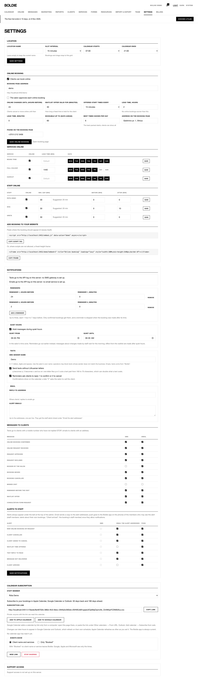

**Settings** has these sections. Staff only see Calendar subscription.

| Section | What is in it |
|---|---|
| Location | Location name, **Slot interval** (5–60 minutes; bookings and drags snap to it), **Calendar starts / ends** (default 07:00–21:00) |
| Online booking | See [Online booking](/online-booking/) |
| Notifications | See [Notifications and messages](/notifications/) |
| Calendar subscription | See [Calendar subscription](/calendar-subscription/) |
| Support access | Owner only: **Grant access for 14 days** lets the Boldie team see your salon to help; **Revoke access** ends it |

