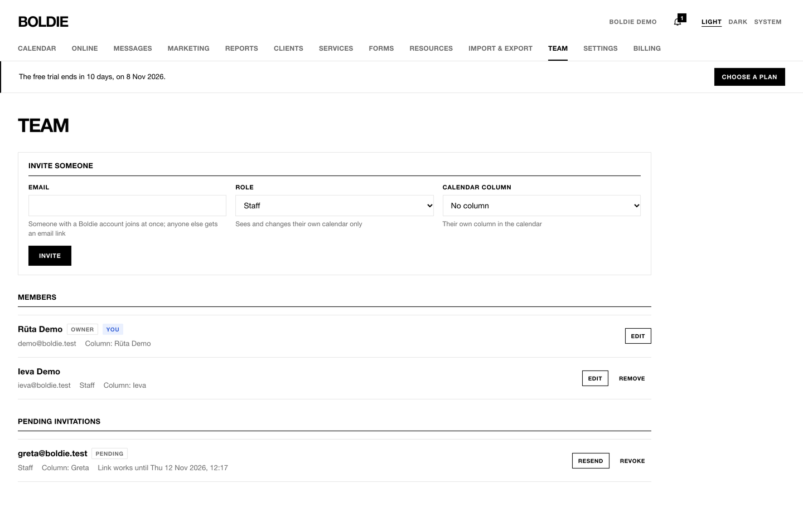
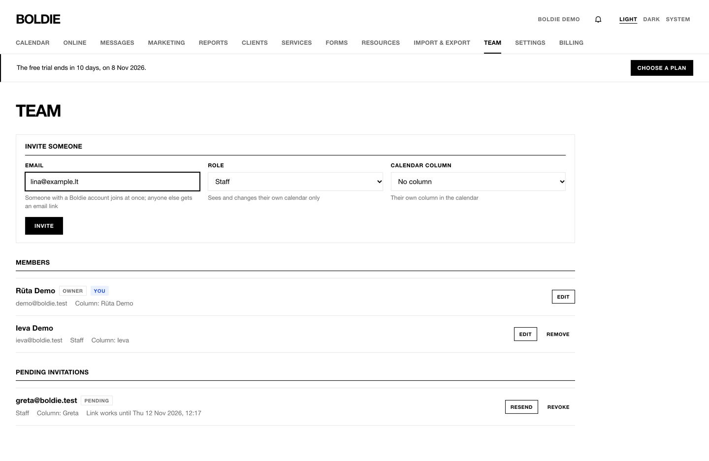
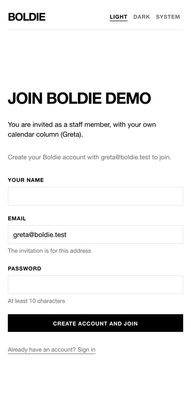

**Team** (owners and managers):

## Invite someone

1. Under **Invite someone**, enter their **Email**.
2. Choose the **Role**: **Manager** (sees every calendar and manages the salon, except billing and exports) or **Staff**
   (sees and changes their own calendar only).
3. Choose their **Calendar column**.
4. Press **Invite**.

Someone who already has a Boldie account joins at once. Anyone else gets an email with a link that works for 14 days.
**Pending invitations** has **Resend** and **Revoke**.

## Accepting an invitation

The invited person opens the link, then **Create account and join** or **Sign in and join** with the invited email.
Boldie opens the salon's calendar.

## Change or remove a member

**Edit** changes the role and column. **Remove** takes someone out of the salon: their bookings stay, and calendar
links they made stop working. The owner's role cannot be changed. **Leave** removes yourself.
